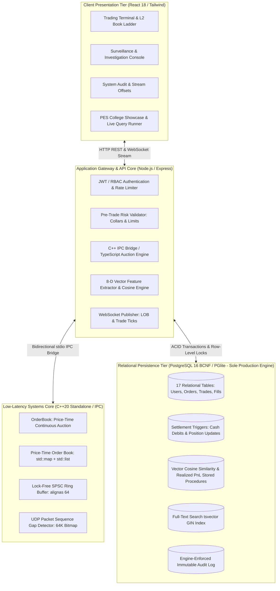
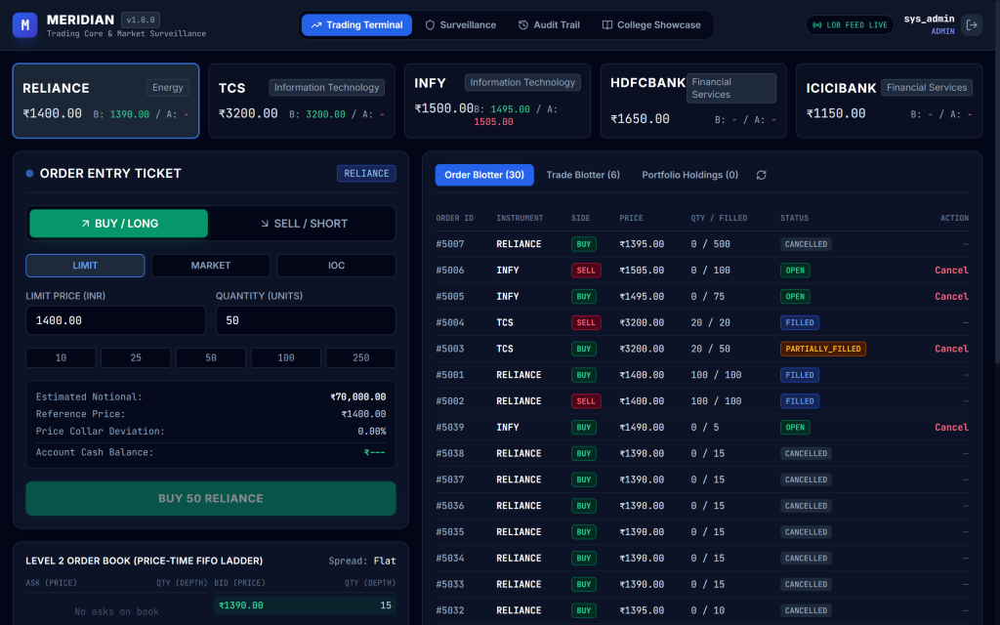

# MERIDIAN

[](engine/)
[](backend/)
[-4169E1?style=flat&logo=postgresql)](database/)
[](frontend/)
[](LICENSE)
[](.github/workflows/ci.yml)

> **High-Performance C++20 Order Matching Engine with PostgreSQL-Backed Trading Workflows, Real-Time Market Data and Multi-Dimensional Market Surveillance.**

**Institution:** PES University, Department of Computer Science & Engineering  
**Academic Course:** DBMS Experiential Learning — Level 3  
**Faculty Evaluator:** Dr. Nagasundari S  
**Student & Author:** Prasanna Marihalkar (`PES1UG24CS684` / `@PrasannaMarihalkar`)  

---

## 1. System Overview & Problem Statement

Financial market infrastructure operates under two conflicting requirements:
1. **Ultra-Low Latency Execution:** Order books must process limit, market, and IOC orders in sub-microsecond timeframes without mutex contention or dynamic memory allocation.
2. **Strict Transactional Persistence & Compliance:** Every match must produce atomic, side-specific clearing records, rebalance cash and position ledgers, maintain an immutable audit trail, and monitor order flow for abusive patterns (such as spoofing, layering, and quote stuffing).

**MERIDIAN** resolves this trade-off through a decoupled, multi-paradigm architecture:
- **Production Relational Ledger & Authoritative Matching:** PostgreSQL `DATABASE` mode is the **sole authoritative production matching engine** for all live order execution, row-level concurrency locking, pre-trade risk controls, double-entry cash balances, position ledger updates, and immutable audit logging across 17 BCNF-normalized entities.
- **Decoupled C++20 High-Performance Engine Core:** Continuous double auction engine utilizing an ordered price-time book (`std::map<Price, std::list<Order>>`), a lock-free Single-Producer Single-Consumer (SPSC) ring buffer, and a bounded 64K-sequence circular bitmap UDP gap detector. Benchmarked at **~3.9 million orders/second** with **152 ns median latency**, operating as a decoupled component for research, simulation, and high-frequency benchmarks.
- **Multi-Dimensional Surveillance Engine:** Extracts an 8-dimensional behavioral feature vector from live order flow and computes **vector cosine similarity** against manipulative benchmark signatures.
- **Institutional Web Terminal:** High-density dark-theme trading interface with real-time Level 2 book ladders, order blotters, surveillance consoles, and an interactive college query runner.

> **Architectural Boundary Note:** To guarantee mathematical ledger integrity and eliminate cross-engine state bifurcation, PostgreSQL `DATABASE` mode acts as the sole production-authoritative source of truth. The standalone C++ matching engine (`engine/meridian_engine`) is compiled and tested as an independent systems component communicating via a hardened stdio IPC correlation bridge. Automatic cross-engine fallback is deliberately prohibited.

---

## 2. High-Level System Architecture



---

## 3. Core Subsystems

### 3.1 C++20 Order Matching Engine (`engine/`)
- **Price-Time Priority (FIFO):** Bids are sorted descending (`price DESC, time ASC`); asks are sorted ascending (`price ASC, time ASC`).
- **Data Structures & Ordering:** Price levels are indexed via `std::map` (red-black tree), guaranteeing $O(\log P)$ price tier lookups and $O(1)$ best-bid/best-ask retrieval. Within each tier, resting orders reside in a `std::list<Order>`, providing $O(1)$ FIFO queue advancement and stable iterators for direct $O(1)$ order cancellation via `std::unordered_map<OrderId, OrderLocation>`.
- **Fixed-Point Pricing:** Prices are mapped to 64-bit integer ticks (`price = double * 10,000`), eliminating floating-point rounding errors and division overhead.
- **Lock-Free SPSC Queue (`include/spsc_queue.hpp`):** Single-Producer Single-Consumer circular queue with atomic head/tail indices isolated on independent 64-byte cache lines (`alignas(64)`) to eliminate false sharing.
- **UDP Gap Detection (`include/gap_detector.hpp`):** Tracks monotonic sequence numbers across multicast market feeds using a pre-allocated 64K circular bitmap (`std::array<uint64_t, 1024>`), providing bounded $O(1)$ gap detection with zero heap allocations on packet ingress.

### 3.2 Relational Database Architecture (`database/`)
The database contains **17 entities in Boyce-Codd Normal Form (BCNF)** across four domains:
1. **Identity & Accounts:** `users`, `sessions`, `accounts`, `risk_limits`
2. **Trading Master Data & Execution:** `instruments`, `orders`, `trades`, `fills`, `positions`, `watchlists`
3. **Surveillance & Compliance:** `surveillance_sessions`, `surveillance_patterns`, `alerts`, `alert_notes`, `surveillance_feature_stats`
4. **System Ledger & Offsets:** `audit_log`, `engine_offsets`

**Database Highlights:**
- **Side-Specific Settlement:** Every matched trade produces exactly one `BUY` and one `SELL` fill record in `fills`, enforced by `UNIQUE(trade_id, side)`.
- **Automatic Settlement Trigger (`trg_fills_settlement`):** Automatically debits/credits cash balances and updates position net quantities and weighted average costs.
- **Immutable Audit Log (`trg_audit_log_immutable`):** Engine-enforced database trigger rejects any `UPDATE` or `DELETE` issued against `audit_log`.
- **Full-Text Search:** Case investigator notes indexed using PostgreSQL `tsvector` and GIN index for sub-millisecond keyword lookup.

### 3.3 Market Surveillance Engine (`backend/services/surveillanceService.ts`)
Extracts an 8-dimensional feature vector across rolling trading windows:
1. `order_cancel_ratio`
2. `quote_to_trade_ratio`
3. `median_lifetime_ms`
4. `size_skew`
5. `msg_rate_per_s`
6. `book_imbalance_impact` (derived from net order volume disparity)
7. `opposite_side_fill_ratio` (fills executed on opposite side of resting orders)
8. `layering_depth` (number of distinct price tiers populated)

Vectors are normalized and compared against seeded manipulation benchmarks using vector cosine similarity (`fn_cosine_similarity`). If similarity exceeds 0.85 or rule flags trip, an alert is raised and streamed over WebSockets.

---

## 4. UI Preview



---

## 5. Performance Benchmarks

Measured on an Intel(R) Core(TM) Ultra 5 125H (18 vCPUs, 16 GB LPDDR5, WSL2 Ubuntu 24.04, GCC 13.3.0 `-O3`):

| Subsystem | Metric | Measured Value | Notes |
|---|---|:---:|---|
| **C++ Matching Engine** | Throughput | **3,886,214 orders/sec** | 100,000 orders across continuous double auction |
| **C++ Matching Engine** | Latency (p50) | **152.5 ns** | Sub-microsecond median match time |
| **C++ Matching Engine** | Latency (p90) | **221.5 ns** | 90th percentile under heavy order flow |
| **C++ Matching Engine** | Latency (p99) | **551.0 ns** | 99th percentile |
| **C++ Matching Engine** | Latency (p99.9) | **3.59 µs** | Tail latency under bursts |
| **REST API Layer** | Latency (p50) | **7.16 ms** | Includes HTTP framing, Express routing, PGlite lookup |
| **REST API Layer** | Latency (avg) | **10.44 ms** | End-to-end loopback request response |
| **Sanitizers** | ASan & UBSan | **0 errors / 0 leaks** | AddressSanitizer and UndefinedBehaviorSanitizer clean |
| **Sanitizers** | ThreadSanitizer | **0 data races** | Lock-free SPSC concurrency verified |

*Detailed benchmark methodology, hardware specs, and reproducibility notes are documented in [docs/PERFORMANCE_REPORT.md](docs/PERFORMANCE_REPORT.md).*

---

## 6. Quick Start & Local Setup

### Prerequisites
- Node.js 22 LTS (recommended) or 20+
- Optional: GCC 13+ with C++20 support (for building the standalone C++ matching engine)

### Single-Command Run
```bash
# 1. Clone repository
git clone https://github.com/PrasannaMarihalkar/meridian-trading-surveillance.git
cd meridian-trading-surveillance

# 2. Install dependencies
npm install

# 3. Initialize and seed database (embedded zero-config PostgreSQL engine included)
npm run db:init

# 4. Build frontend bundle
npm run build:frontend

# 5. Start the full-stack server
npm start
```
Open **`http://localhost:4000`** in your browser.

### Pre-Configured Demo Personas
- **Trader:** `prasanna_trader` / `Password123!`
- **Analyst:** `asha_analyst` / `Password123!`
- **Admin:** `sys_admin` / `Password123!`

---

## 7. Verification & Testing

```bash
# 1. Run Complete Automated Test Suite (6 test suites, 57/57 assertions passed)
# Includes: Transaction Affinity (4) + Auth/RBAC Hardening (9) + Trading/Risk Integrity (13) + API Integration (15) + Concurrency Stress (4) + C++ Bridge (12)
npm run test:all

# 2. Run Backend Integration & Idempotency Test Suite (15/15 passed)
npm test

# 3. Run Auth, Session Lifecycle, WS Ticket & RBAC Hardening Test Suite (9/9 passed)
npm run test:auth

# 4. Run Financial Risk, Order Lifecycle & Sequence Integrity Test Suite (13/13 passed)
npm run test:risk

# 5. Run PostgreSQL Transaction Connection Affinity Verification (4/4 assertions passed)
npm run test:affinity

# 6. Run Multi-Connection Concurrency, Row-Locking & Rollback Isolation Stress Test (4/4 steps passed)
npm run test:concurrency

# 7. Run Hardened C++ Stdio IPC Bridge Test (12/12 passed)
npm run test:bridge

# 8. Verify Database Schema, Atomicity & Rollbacks on Disposable Instance
npx tsx scripts/verify_disposable_db.ts

# 9. Execute All 17 Official College Demonstration SQL Queries
npm run demo:queries

# 10. Compile and Run Standalone C++ Matching Engine Tests (Linux / WSL)
g++ -std=c++20 -O3 -pthread -Iengine/include engine/src/order_book.cpp engine/tests/test_order_book.cpp -o test_ob && ./test_ob

# 11. Run C++ Engine Tests with Memory Sanitizers (AddressSanitizer & UndefinedBehaviorSanitizer)
g++ -std=c++20 -O1 -fsanitize=address,undefined -fno-omit-frame-pointer -pthread -Iengine/include engine/src/order_book.cpp engine/tests/test_order_book.cpp -o test_ob_asan && ./test_ob_asan

# 12. Run C++ High-Throughput Benchmark (100,000 orders)
g++ -std=c++20 -O3 -pthread -Iengine/include engine/src/order_book.cpp engine/benchmarks/benchmark_engine.cpp -o bench_ob && ./bench_ob
```

---

## 8. College DBMS Level 3 Deliverables

This repository fulfills all course requirements for **DBMS Experiential Learning (Level 3)** at PES University under **Dr. Nagasundari S**:
- **7-Page Peter Chen Notation ER Model:** [docs/ER_DIAGRAM.md](docs/ER_DIAGRAM.md) and [docs/college/MERIDIAN_ER_Diagram_Chen_Notation.pdf](docs/college/MERIDIAN_ER_Diagram_Chen_Notation.pdf).
- **Formal Relational Schema & BCNF Proofs:** [docs/RELATIONAL_SCHEMA.md](docs/RELATIONAL_SCHEMA.md).
- **Comprehensive Data Dictionary (17 Tables):** [docs/DATA_DICTIONARY.md](docs/DATA_DICTIONARY.md).
- **17 Demonstration Queries with Business Context:** [docs/DEMO_GUIDE.md](docs/DEMO_GUIDE.md).
- **Requirement Traceability Matrix:** [docs/FEATURE_TRACEABILITY.md](docs/FEATURE_TRACEABILITY.md).
- **Technical Viva Preparation Guide:** [docs/VIVA_PREPARATION.md](docs/VIVA_PREPARATION.md).

---

## 9. Technical Documentation Index

- [FINAL_REMEDIATION_REPORT.md](docs/engineering/FINAL_REMEDIATION_REPORT.md): Comprehensive final remediation audit & teacher demonstration report.
- [FINAL_REMEDIATION_PLAN.md](docs/engineering/FINAL_REMEDIATION_PLAN.md): Engineering blueprint and root-cause analysis for 10 remediation areas.
- [RELEASE_NOTES.md](docs/RELEASE_NOTES.md): v1.0.0 production release notes.
- [FINAL_RELEASE_AUDIT.md](docs/FINAL_RELEASE_AUDIT.md): Master release verification report.
- [DATABASE_PRODUCTION_REVIEW.md](docs/DATABASE_PRODUCTION_REVIEW.md): Database constraint, trigger, and index hardening audit.
- [CPP_ENGINE_REVIEW.md](docs/CPP_ENGINE_REVIEW.md): Systems-level review of memory, concurrency, and order books.
- [SECURITY_RELEASE_REVIEW.md](docs/SECURITY_RELEASE_REVIEW.md): Security posture, RBAC, and risk assessments.
- [FRONTEND_RELEASE_REVIEW.md](docs/FRONTEND_RELEASE_REVIEW.md): Multi-viewport UI/UX review.
- [PERFORMANCE_REPORT.md](docs/PERFORMANCE_REPORT.md): Reproducible C++ and REST API latency benchmarks.
- [OPERATIONS_RUNBOOK.md](docs/OPERATIONS_RUNBOOK.md): System management and troubleshooting runbook.
- [PRODUCTION_DEPLOYMENT.md](docs/PRODUCTION_DEPLOYMENT.md): Cloud hosting comparison (Railway, Render, Fly.io).
- [CI_CD.md](docs/CI_CD.md): GitHub Actions continuous integration guide.
- [KNOWN_LIMITATIONS.md](docs/KNOWN_LIMITATIONS.md): Transparent engineering disclosures and trade-offs.

---

## 10. License & Academic Attribution

Developed by **Prasanna Marihalkar** (`PES1UG24CS684`), Department of Computer Science and Engineering, PES University, Bengaluru.  
Course Instructor: **Dr. Nagasundari S**  
Licensed under the [MIT License](LICENSE).
