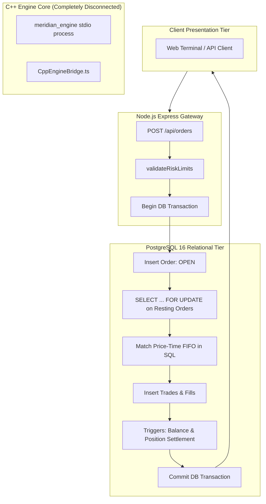
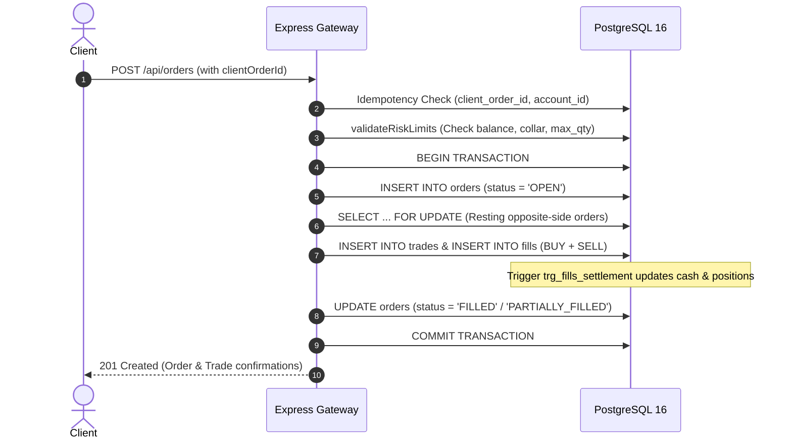
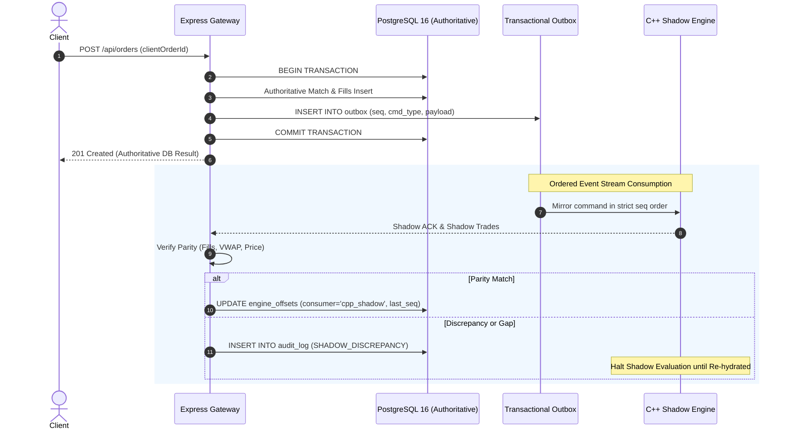
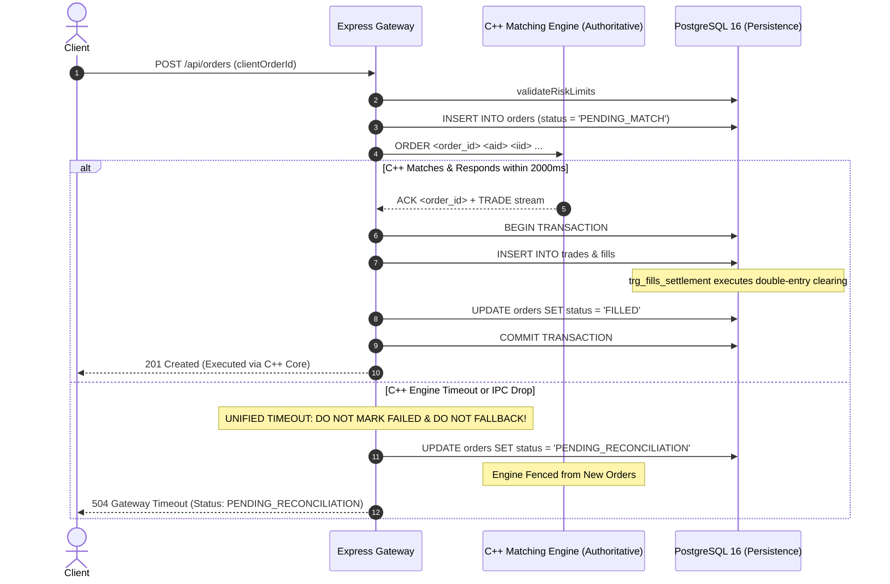

# MERIDIAN — Matching Engine Execution & Integration Architecture Decision
**Document ID:** `MERIDIAN-ARCH-DEC-002`  
**Revision:** 2.0 (Post-Review Revision)  
**Execution Stage:** Stage 2 Pre-Implementation Architecture Gate  
**Target Repository:** `https://github.com/PrasannaMarihalkar/meridian-trading-surveillance`  
**Author & Lead Architect:** Principal Systems Architect & Technical Quality Lead  
**Date:** November 17, 2026  
**Status:** **REVISED ARCHITECTURAL DECISION & STAGE 2 BOUNDARY SPECIFICATION**  

---

## 1. Executive Summary & Problem Context

In Stage 1, a fundamental architectural disconnect was uncovered:
- **Actual Runtime Reality:** `TradingService.submitOrder()` executes matching entirely within PostgreSQL using an atomic transaction with `SELECT ... FOR UPDATE` row locks.
- **Isolated C++ Engine:** The C++ matching engine (`engine/meridian_engine`) and its IPC wrapper (`CppEngineBridge`) exist separately and are never invoked in the production request path.
- **Flawed Prior Proposal:** The initial implementation proposal suggested a tri-mode architecture (`CPP`, `DATABASE`, `HYBRID`) featuring *automatic fallback from C++ to database matching upon error or timeout*.

### 1.1 The Core Architectural Hazard: Dual-State Split-Brain
In any decoupled architecture combining an asynchronous in-memory process (C++ order book) and an ACID relational datastore (PostgreSQL), **automatic, uncoordinated fallback upon timeout or error is fundamentally unsafe and mathematically invalid**:
- If the C++ engine processes an aggressive order in memory but communication to the backend times out, falling back to database matching executes the order a second time against a completely different book.
- This creates **duplicate executions**, **negative cash balances**, **oversold position states**, and **permanent desynchronization** between in-memory resting orders and database records.

### 1.2 Core Architectural Invariant: The Single-Authority Rule
At any given instant for any given instrument, **exactly ONE matching authority** must be designated:
1. **`DATABASE` mode:** PostgreSQL is the sole matching authority. C++ engine is offline or unused. (Default & Production Baseline).
2. **`HYBRID` mode:** Redefined strictly as an **Authoritative PostgreSQL + C++ Shadow Comparison Mode**. PostgreSQL matches authoritatively; commands are mirrored asynchronously to the C++ shadow engine for latency and price parity telemetry; **shadow C++ executions are NEVER persisted to database tables**.
3. **`CPP` mode:** C++20 engine is the sole matching authority. It operates with strict **Hard Fail-Safe Semantics**: if the C++ engine times out or disconnects, the order **FAILS SAFELY**—it is **NEVER silently routed to database matching**.

---

## 2. Existing vs. Proposed Architecture

### 2.1 Existing Architecture
Currently, order flow is 100% contained within the Node.js / PostgreSQL boundary. The C++ engine sits idle as an external executable:



### 2.2 Proposed Multi-Mode Architecture
The proposed architecture introduces strict single-authority execution governed by `MERIDIAN_EXECUTION_MODE`:

```mermaid
flowchart TD
    subgraph Ingress ["Order Ingress & Risk Validation"]
        REQ[Order Request] --> IDEM[Idempotency & ClientOrderId Check]
        IDEM --> RISK[Pre-Trade Risk & Price Collar Filter]
    end

    subgraph ModeSwitch {"Execution Mode Router"}
        RISK --> MODE{MERIDIAN_EXECUTION_MODE}
    end

    subgraph ModeDB ["Mode: DATABASE (Authoritative Default)"]
        MODE -->|DATABASE| DB_AUTH[Authoritative PostgreSQL Matching]
        DB_AUTH --> DB_PERSIST[Atomic Triggers & Fills Settlement]
    end

    subgraph ModeHybrid ["Mode: HYBRID (Authoritative DB + Shadow C++)"]
        MODE -->|HYBRID| DB_AUTH_H[Authoritative PostgreSQL Matching]
        DB_AUTH_H --> DB_PERSIST_H[Atomic Triggers & Fills Settlement]
        DB_PERSIST_H --> OUTBOX[Transactional Outbox Append]
        OUTBOX --> MIRROR[Async Mirror Command to C++ Shadow]
        MIRROR --> SHADOW_COMP[Compare Parity: Fills, Price, Latency]
        SHADOW_COMP --> TELEMETRY[Log Shadow Metrics / Telemetry]
    end

    subgraph ModeCPP ["Mode: CPP (Authoritative C++ Engine)"]
        MODE -->|CPP| CPP_CHK{Engine Ready & Synced?}
        CPP_CHK -->|No| FAIL_SAFE[Fail-Safe Rejection: ENGINE_UNAVAILABLE]
        CPP_CHK -->|Yes| CPP_DISPATCH[Dispatch to C++ Engine via IPC]
        CPP_RESP{ACK or TIMEOUT?}
        CPP_DISPATCH --> CPP_RESP
        CPP_RESP -->|Timeout / Crash| HARD_FAIL[Mark Order PENDING_RECONCILIATION / Never Fallback]
        CPP_RESP -->|ACK & Trades| CPP_PERSIST[Atomic Insert Fills & Trades in DB]
        CPP_PERSIST -->|DB Fail| DESYNC_HALT[Halt Engine & Mark Desynchronized]
    end

    DB_PERSIST --> OUT[Response to Client]
    DB_PERSIST_H --> OUT
    CPP_PERSIST --> OUT
    FAIL_SAFE --> OUT
    HARD_FAIL --> OUT
```

---

## 3. Explicit Execution-Mode Semantics

### 3.1 Mode `DATABASE` (Authoritative Production Default)
- **Role:** The primary, canonical matching engine.
- **Status:** **Active by default** in all production, college evaluation, and CI workflows.
- **Mechanics:**
  - Standard PostgreSQL row-level locking (`SELECT ... FOR UPDATE`).
  - Fills, cash balances, positions, and audit logs are settled atomically in a single ACID transaction.
  - Zero dependency on external processes or WSL.
  - C++ engine child process is not spawned or is kept strictly offline.
- **Invariants:** 100% backward-compatible; passes all existing 9 API integration tests and 17 demonstration queries.

### 3.2 Mode `HYBRID` (Authoritative DB + C++ Shadow Comparison)
- **Role:** Shadow comparison and telemetry engine.
- **Principle:** **Never allow both engines to execute the same order authoritatively. Zero C++ trade persistence.**
- **Mechanics:**
  1. PostgreSQL processes the order authoritatively, generating canonical trades and fills.
  2. Within the same transaction, an ordered event is written to the durable outbox stream with a monotonic sequence number.
  3. The transaction commits and returns the official response to the client.
  4. In an asynchronous worker, the shadow C++ engine consumes events strictly ordered by sequence number.
  5. The backend compares:
     - Match count parity: $N_{DB} \stackrel{?}{=} N_{CPP}$
     - Traded quantity parity: $Q_{DB} \stackrel{?}{=} Q_{CPP}$
     - Volume-weighted average price (VWAP) parity: $P_{DB} \stackrel{?}{=} P_{CPP}$
  6. Discrepancies are logged to `audit_log` with action `SHADOW_DISCREPANCY` for compliance inspection.
  7. **Crucial Safety Rule:** Trades generated by the shadow C++ engine are **NEVER** persisted to the `trades` or `fills` database tables.

### 3.3 Mode `CPP` (Authoritative C++ with Hard Fail-Safe)
- **Role:** High-throughput in-memory matching authority.
- **Status:** Explicitly gated opt-in mode behind a feature flag (`MERIDIAN_EXECUTION_MODE=CPP`), disabled in Stage 2.
- **Pre-Conditions for Activation:**
  1. Complete startup reconciliation: C++ engine state is fully reconstructed from durable command history.
  2. The IPC bridge is connected and healthy (`isAvailable() === true`).
- **Mechanics:**
  1. Pre-trade risk validations run in Node.js.
  2. Order is assigned a sequence and written to `orders` table with status `PENDING_MATCH`.
  3. Command is dispatched over stdio pipe to C++ engine with an explicit correlation ID (`order_id`).
  4. If C++ matches:
     - C++ emits `ACK` and `TRADE` records.
     - Backend begins a PostgreSQL transaction.
     - Inserts the trades and side-specific fills into PostgreSQL.
     - Updates order status to `FILLED`, `PARTIALLY_FILLED`, or `OPEN`.
     - Database triggers settle cash and positions.
     - Commits transaction and returns response.
- **Fail-Safe Rules & Unified Timeout Semantics:**
  - **No Automatic Fallback:** If C++ times out, disconnects, or crashes, the order MUST NOT be routed to PostgreSQL matching. 
  - **Ambiguous State Handling:** If communication times out after command dispatch, the order is transitioned to `PENDING_RECONCILIATION` (or `UNKNOWN`). It is **NEVER** marked as definitively failed, and **NEVER** dispatched to another matching engine until reconciliation establishes its actual outcome.
  - **Fail-Fast on Desynchronization:** If the database transaction fails after C++ generated matches, trading is immediately halted (`HALTED_DESYNCHRONIZED`) and the engine is fenced from accepting new commands until an administrator reconciles state.

---

## 4. Sequence Diagrams

### 4.1 Mode `DATABASE` Execution Flow


### 4.2 Mode `HYBRID` Shadow-Comparison Flow (Outbox Stream)


### 4.3 Mode `CPP` Authoritative Execution & Unified Timeout Semantics


---

## 5. Comprehensive Failure-Scenario Evaluation Matrix

| Scenario ID | Failure Event | Naive Automatic Fallback Disaster | Safe Design Behavior (Adopted Architecture) | Prevention & Recovery Mechanism |
| :--- | :--- | :--- | :--- | :--- |
| **SCN-01** | C++ processes order, but PostgreSQL fails to persist trades. | DB transaction rolls back; backend attempts DB match. Order matched twice; C++ RAM has consumed resting orders that DB believes are still open. | **Hard-Halt & Engine Fencing:** Backend flags C++ engine as `DESYNCHRONIZED`. Rejects all new orders. Does NOT fallback to DB. | C++ engine is fenced, restarted, and re-hydrated from persistent command log. |
| **SCN-02** | PostgreSQL commits, but C++ process crashes before responding. | Backend falls back to DB matching. Order double-executed while C++ state is destroyed. | In `CPP` mode, backend marks order `PENDING_RECONCILIATION`. In `HYBRID` mode, DB match is already canonical; C++ crash only interrupts shadow telemetry. | Process supervisor auto-restarts C++ engine; replay catches up to authoritative DB checkpoint. |
| **SCN-03** | Backend times out waiting for C++, but C++ processed the order. | Backend sends order to DB matching. **Disaster:** Order executed on both engines against different books. | **Unified Timeout Semantics:** Backend transitions order to `PENDING_RECONCILIATION`. **Never marks failed, never dispatches to another engine.** | Correlation ID (`order_id`) used during reconciliation to establish whether engine executed before finalizing state. |
| **SCN-04** | Client retries order submission (network drop on response leg). | Backend assigns a new `order_id` (via `randomUUID()`); matches twice on book. | **Client-Supplied Idempotency Gate:** Enforces `(account_id, client_order_id)` uniqueness. Identical payload returns original order and trades; differing payload is rejected with 409 Conflict. | Unique database index on `client_order_id` and payload hash verification. |
| **SCN-05** | C++ engine restarts and loses its in-memory order book. | C++ boots with empty book. Next aggressive order finds no liquidity and cancels/rests incorrectly. | **Deterministic Replay & Fencing:** Engine is fenced upon boot. Replays complete sequence of active orders and events from durable outbox log before un-fencing. | `engine_offsets` table tracks `last_seq`. Replay verifies book checksum before accepting client traffic. |
| **SCN-06** | Cancellation reaches C++ engine but database commit fails. | DB transaction aborts; C++ cancelled order in RAM. DB says order is OPEN; C++ says order does not exist. | **Durable Cancellation Lifecycle:** DB records `CANCEL_PENDING` first. C++ ACK is recorded. If DB fails, order remains `CANCEL_PENDING` until reconciliation resolves it. | No distributed 2-phase claim. Fenced reconciliation aligns DB and memory states. |
| **SCN-07** | Order is accidentally executed by both matching engines. | Cash balance goes negative; shares duplicated; positions distorted. | **Single-Authority Invariant:** An instrument is exclusively routed to ONE engine. Dual active execution is architecturally prohibited. | Route switch is mutually exclusive based on strict enum (`DATABASE \| HYBRID \| CPP`). |
| **SCN-08** | Two concurrent requests create inconsistent order book state. | Race condition in stdio buffer interleaves lines; responses mismatched to wrong promises in naive FIFO queue. | **Command-Response Correlation:** Line protocol requires every line to start with correlation sequence (`ACK <order_id>`, `TRADE <seq> <order_id>`). | Request queue indexes by `order_id` map rather than naive FIFO shift `requestQueue[0]`. |
| **SCN-09** | DB transaction fails after C++ generated multiple fills. | Fills 1 and 2 persisted; fill 3 hits lock timeout or disk error. Partial DB state desynchronized from C++. | PostgreSQL `BEGIN ... ROLLBACK` ensures 0 partial DB writes. Engine is immediately marked `HALTED_DESYNCHRONIZED` and fenced. | Whole-batch transactional boundary ensures atomicity. |

---

## 6. Detailed Technical Strategies

### 6.1 Client-Supplied Idempotency Strategy
The existing implementation contained a critical vulnerability: `TradingService.ts` generated `clientOrderId` internally using `randomUUID()`, completely defeating client network retry protection.

#### The New Client Idempotency Contract:
1. **Client Header / Body Parameter:** Clients MUST supply `clientOrderId` (UUID string) in the order placement request body or via `Idempotency-Key` HTTP header.
2. **Account Scoping & Schema Enforcement:**
   - Enforce uniqueness on `(account_id, client_order_id)` in `orders` table.
3. **Behavioral Semantics:**
   - **Legitimate Retry (Identical Payload):** If a request arrives with an existing `client_order_id` for that `account_id`, the backend verifies that the payload (symbol, side, type, price, quantity) matches the existing order. If identical, it returns `200 OK` with the existing order and its executed trades without re-executing.
   - **Conflicting Reuse (Differing Payload):** If the payload differs, the backend immediately returns `409 Conflict` with error message `"Idempotency key reused with differing order parameters"`.
   - **In-Flight Locking:** An in-memory/DB lock ensures that if two identical requests arrive concurrently, the second waits for the first to complete rather than running concurrently.

### 6.2 Deterministic Engine Recovery Strategy
A PostgreSQL snapshot of `OPEN` orders alone is **not** a complete recovery mechanism. It does not account for in-flight sequence gaps, partially filled order priority drift, or uncommitted trades.

#### Recovery Lifecycle Across Failure Points:
1. **Engine crash before processing command:** Command remains unacknowledged; backend marks `PENDING_RECONCILIATION`. On engine reboot, command is re-submitted with original `order_id`. Engine detects no duplicate and processes it cleanly.
2. **Engine crash after processing but before DB persistence:** In-memory state lost. DB has order in `PENDING_MATCH`. Replay log replays the command. Engine matches deterministically and re-emits trades. DB persists trades.
3. **Database commit failure:** DB rolled back; engine has mutated state. Engine is marked `DESYNCHRONIZED`. Engine is restarted, memory cleared, and replayed from the last committed DB checkpoint sequence in `engine_offsets`.
4. **Backend crash after DB commit:** DB has committed record. Engine has processed it. Client retries with same `client_order_id`. Idempotency gate finds committed record and returns it. Zero replay needed.
5. **Lost acknowledgement over IPC:** Backend times out, marks `PENDING_RECONCILIATION`. Reconciliation queries engine using `SNAPSHOT` or order lookup by `order_id`. If engine executed it, backend commits DB; if engine never saw it, backend re-dispatches or rejects.
6. **Duplicate command delivery:** Engine maintains a fixed ring buffer of recent processed `order_id`s. If duplicate received, it re-emits the original `ACK` without re-executing.
7. **Partial execution crash:** Engine partially fills order and crashes before emitting all `TRADE` lines. On reboot and replay, the engine deterministically re-executes the partial fill up to the exact quantity.
8. **Engine Fencing During Recovery:** Whenever the engine boots or enters recovery, an atomic flag `fenced = true` rejects all incoming client commands with `503 Service Unavailable (Engine Reconciling)` until all historical events are replayed and state parity is verified.

### 6.3 Durable Cancellation Lifecycle
A C++ cancellation acknowledgement followed by a failed PostgreSQL transaction is **not** atomic. Two-phase acknowledge does not provide distributed atomicity.

#### The Safe Cancellation Protocol:
1. **Durable Intent Record:** When `cancelOrder(orderId)` is invoked, PostgreSQL updates the order:
   ```sql
   UPDATE orders SET status = 'CANCEL_PENDING', cancel_requested_at = NOW() WHERE order_id = $1;
   ```
2. **Command Dispatch:** Backend dispatches `CANCEL <order_id> <instrument_id>` with monotonic command sequence to C++ engine.
3. **Engine Action:**
   - If resting: C++ engine removes order from book and emits `CANCELLED <order_id>`.
   - If already filled: C++ emits `CANCEL_REJECTED <order_id> ALREADY_FILLED`.
4. **Durable Finalization:**
   - On `CANCELLED`: PostgreSQL updates status from `CANCEL_PENDING` to `CANCELLED`.
   - On `CANCEL_REJECTED`: PostgreSQL updates status to `FILLED` (or leaves `PARTIALLY_FILLED`).
5. **Reconciliation on Crash:** If backend crashes during steps 3-4, order remains in `CANCEL_PENDING`. Reconciliation queries engine state on reboot and resolves the order to `CANCELLED` or `FILLED`. At no point can a cancelled order be resurrected into `OPEN`.

### 6.4 HYBRID Mode: Transactional Outbox & Sequence Gap Tracking
To make HYBRID shadow comparison trustworthy:
1. **Transactional Outbox Table:**
   Every authoritative order insertion, execution, and cancellation in PostgreSQL writes an event row inside the same SQL transaction:
   ```sql
   INSERT INTO outbox_events (event_id, event_type, payload, created_at)
   VALUES (nextval('outbox_seq'), 'ORDER_PLACED', json_build_object(...), NOW());
   ```
2. **Ordered Shadow Consumption:**
   A dedicated background worker reads `outbox_events` ordered strictly by `event_id ASC` and pipes them to the C++ shadow engine.
3. **Offset Checkpointing:**
   The worker updates `engine_offsets` (`consumer = 'cpp_shadow'`, `last_seq = event_id`).
4. **Gap Detection & Fencing:**
   - If `outbox_events.event_id != last_seq + 1`, a sequence gap is detected.
   - The shadow engine is immediately marked `SHADOW_DESYNCHRONIZED`.
   - Parity comparison is suspended immediately.
   - The shadow engine is reset, memory wiped, and replayed from the beginning of the outbox log.
   - Only when `shadow_last_seq === outbox_head_seq` is shadow comparison resumed.
5. **Authoritative Guarantee:** PostgreSQL remains 100% authoritative. Shadow C++ engine never writes to `trades` or `fills`.

---

## 7. Concrete Stage 2 Scope vs. Future Implementation Boundary

To prevent premature distributed complexity and maintain rock-solid software quality, the boundary of what Stage 2 will implement is explicitly defined:

```
Boundary Specification:
┌────────────────────────────────────────────────────────┬─────────────────────┬─────────────────────────────────┐
│ Component / Capability                                 │ Stage 2 Scope       │ Future Scope (Stage 3+)         │
├────────────────────────────────────────────────────────┼─────────────────────┼─────────────────────────────────┤
│ Authoritative Matching Engine                          │ DATABASE (Postgres) │ CPP (Optional opt-in mode)      │
│ Client-Supplied Idempotency Contract                   │ IMPLEMENT IN STAGE 2│ Extended multi-region tokens    │
│ C++ IOC Order Cancellation Fix & Unit Tests            │ IMPLEMENT IN STAGE 2│ Intrusive memory pools          │
│ Gap Detector Memory Hardening (Bounded Window)         │ IMPLEMENT IN STAGE 2│ Hardware kernel bypass UDP      │
│ Standalone C++ Engine Binary Compilation in CI         │ IMPLEMENT IN STAGE 2│ Multi-platform release packages │
│ C++ Bridge Correlated Responses by order_id            │ IMPLEMENT IN STAGE 2│ High-throughput binary ring IPC │
│ Blocking CI Integration Test for IPC Bridge            │ IMPLEMENT IN STAGE 2│ Distributed chaos injection     │
│ Documentation Reconciliation (Truth in Docs)           │ IMPLEMENT IN STAGE 2│ Continuous doc testing          │
├────────────────────────────────────────────────────────┼─────────────────────┼─────────────────────────────────┤
│ Transactional Outbox Table & Event Stream              │ DEFERRED            │ IMPLEMENT IN FUTURE STAGE       │
│ Live HYBRID Shadow Comparison Stream                   │ DEFERRED            │ IMPLEMENT IN FUTURE STAGE       │
│ Authoritative CPP Matching with Hydration Replay       │ DEFERRED            │ IMPLEMENT IN FUTURE STAGE       │
│ Automatic Cross-Engine Fallback                        │ PERMANENTLY REJECTED│ NEVER IMPLEMENT (UNSAFE)        │
└────────────────────────────────────────────────────────┴─────────────────────┴─────────────────────────────────┘
```

### What Stage 2 Will Implement:
1. **`DATABASE` Mode as Sole Authoritative Engine:** All trade matching and settlement remain inside PostgreSQL ACID transactions.
2. **Client-Supplied Idempotency:** Update `orderRoutes.ts` and `TradingService.ts` to accept `clientOrderId`, validate against authenticated account, and reject mismatched duplicate payloads with 409 Conflict.
3. **C++ IOC Correctness (`FINDING-CPP-01`):** Patch `engine/src/order_book.cpp` to correctly set `order.status = OrderStatus::CANCELLED` when an IOC order remainder is cancelled. Add unit tests in `engine/tests/test_order_book.cpp`.
4. **Gap Detector Memory Hardening (`FINDING-CPP-02`):** Refactor `engine/include/gap_detector.hpp` to use a bounded sliding sequence history rather than unbounded `std::unordered_set`.
5. **Standalone Engine Compilation in CI (`FINDING-CI-01`):** Update `.github/workflows/ci.yml` to compile `engine/src/main.cpp` into `engine/meridian_engine`.
6. **Cross-Platform Bridge & Correlated IPC (`FINDING-ARCH-02`, `SCN-08`):** Update `backend/services/cppEngineBridge.ts` to detect native Windows binaries before WSL, and index pending requests by `order_id` map rather than naive FIFO queues.
7. **Blocking CI Test (`FINDING-CI-02`):** Run `tests/cpp_bridge.test.ts` as a blocking test against the compiled engine binary.
8. **Documentation Reconciliation (`FINDING-DOC-01`):** Update `README.md` and `docs/ARCHITECTURE.md` to accurately describe standard library container architecture (`std::map` and `std::list`), removing false claims.

---

## 8. Summary of Document Updates

The following governance documents have been updated to reflect this revised architectural decision:

1. **`docs/engineering/IMPLEMENTATION_PLAN.md`:**
   - Phase 2 redefined: "Architectural Hardening, Client Idempotency, and Correlated IPC Bridge".
   - `DATABASE` established as the only authoritative matching mode in Stage 2.
   - `CPP` authoritative mode and `HYBRID` outbox streaming explicitly designated as future scope.
   - Blanket automatic fallback explicitly banned.
2. **`docs/engineering/ACCEPTANCE_MATRIX.md`:**
   - `REQ-INT-01` updated to specify single-authority `DATABASE` execution for Stage 2, with client idempotency and correlation ID protocol.
3. **`.agents/skills/meridian-implementation/SKILL.md`:**
   - Protocol 1 updated with client idempotency enforcement.
   - Protocol 2 updated to forbid automatic fallback, mandate `order_id` correlation, and enforce single-authority `DATABASE` execution.

---

## 9. List of Unresolved Architectural Risks (Transparent Disclosure)

Before entering Stage 2 implementation, the following architectural risks are noted:

1. **Risk 1: Volatile Memory Boundary in Future CPP Mode**  
   *Description:* When authoritative C++ mode is eventually built in future stages, unexpected process termination (SIGKILL, power loss) destroys unpersisted matching state.  
   *Mitigation:* Keeping `DATABASE` as the sole authoritative engine in Stage 2 completely neutralizes this risk for the current release. Future CPP mode will require full transactional outbox and write-ahead command logging before activation.

2. **Risk 2: Windows WSL Cold-Boot Latency in Bridge Tests**  
   *Description:* On Windows developer machines without native C++ compilation tools, invoking WSL incurs a 3-5 second cold-start delay.  
   *Mitigation:* `cppEngineBridge.ts` will prioritize native `meridian_engine.exe` if present, increase default timeout to 6000ms, and ensure clean shutdown to prevent orphaned WSL processes.

3. **Risk 3: Test Isolation with In-Memory PGlite vs Production PostgreSQL 16**  
   *Description:* PGlite (WASM) runs in-memory single-threaded, which does not simulate physical PostgreSQL connection limits or network socket dropouts.  
   *Mitigation:* Maintained CI schema validation and disposable database verification scripts against native PostgreSQL 16.
