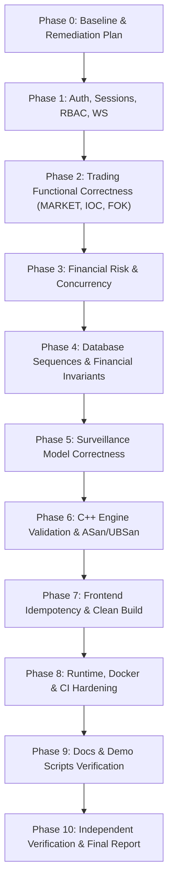

# MERIDIAN — FINAL COMPREHENSIVE REMEDIATION PLAN

**Document Version:** 1.0.0  
**Baseline Commit:** `c8e5ce5` on `main`  
**Target Branch:** `fix/final-teacher-demo-readiness`  
**Status:** Approved for Implementation  
**Execution Objective:** Resolve all discovered security, financial, concurrency, quantitative, and architectural defects to achieve verified Teacher-Demo Readiness.

---

## 1. Executive Summary & Forensic Audit Findings

An independent forensic source code audit conducted on commit `c8e5ce5` identified 10 key defect areas spanning security, transaction integrity, order execution semantics, risk checks, surveillance mathematics, and C++ engine input validation. Although CI run `44120857709` previously passed with 10/10 green jobs, the underlying codebase contained critical logic errors and missing regression tests that would fail under academic and adversarial scrutiny.

This document establishes the precise remediation specifications, reproduction cases, root-cause analyses, implementation changes, and regression tests required across Phases 1 through 9.

---

## 2. Remediation Matrix & Defect Specifications

### Finding 1: Unrestricted Public Registration of ADMIN / ANALYST Roles
- **Classification:** CRITICAL (CWE-284: Improper Access Control)
- **Affected File(s):** `backend/routes/authRoutes.ts` (lines 16–27), `backend/services/authService.ts`
- **Reproduction:** Sending `POST /api/auth/register` with `{"username": "attacker", "password": "Password123!", "role": "ADMIN"}` succeeds without authentication, granting full administrative privileges.
- **Root Cause:** `RegisterSchema` permits `z.enum(['TRADER', 'ANALYST', 'ADMIN']).default('TRADER')` in the unauthenticated public endpoint.
- **Correction:**
  1. Remove `role` from public `RegisterSchema` in `authRoutes.ts`; all public registrations default strictly to `TRADER` role and create a default trading account.
  2. Implement an authenticated endpoint `POST /api/auth/users` (or `POST /api/admin/users`) protected by `authenticate` and `requireRole('ADMIN')` for provisioning `ANALYST` and `ADMIN` accounts.
  3. Support a one-time bootstrap mechanism if zero users exist in the database (or via seeded admin user).
- **Automated Regression Test:** `tests/test_auth_rbac_hardening.ts` verifies:
  - Attempting to pass `role: 'ADMIN'` or `role: 'ANALYST'` to `POST /api/auth/register` ignores the role or rejects it, always creating a `TRADER`.
  - Unauthenticated access to `POST /api/auth/users` returns 401. Non-admin access returns 403. Admin access successfully provisions analyst/admin.
- **Acceptance Criteria:** Zero unauthenticated users can acquire `ADMIN` or `ANALYST` role via public endpoints.

---

### Finding 2: Incomplete Session Lifecycle & Token Revocation
- **Classification:** HIGH (CWE-613: Insufficient Session Expiration)
- **Affected File(s):** `backend/middleware/auth.ts` (lines 20–35), `backend/services/authService.ts` (lines 145–165), `backend/routes/authRoutes.ts`
- **Reproduction:** Calling `POST /api/auth/logout` returns `{ "message": "Logged out successfully" }` but performs no database writes. The issued JWT token continues to authenticate requests until its signature expires. Furthermore, deactivating a user (`is_active = false`) does not invalidate active JWTs.
- **Root Cause:** JWT payload lacks a unique session identifier (`sessionId`/`jti`). The `sessions` table in PostgreSQL is populated during login, but `authenticate` middleware never queries it.
- **Correction:**
  1. Add `sessionId: string` to `AuthTokenPayload`. Generate a UUID `sessionId` upon login and insert into `sessions` with `expires_at = NOW() + INTERVAL '24 hours'`.
  2. In `authenticate` middleware: extract `sessionId` from verified JWT. Query `sessions` table joining `users` to verify:
     - Session row exists.
     - `expires_at > NOW()`.
     - `users.is_active = true`.
  3. In `POST /api/auth/logout`: extract `req.user.sessionId`, execute `DELETE FROM sessions WHERE session_id = $1`, and record `USER_LOGOUT` in `audit_log`.
- **Automated Regression Test:** `tests/test_session_lifecycle.ts` verifies:
  - Valid token works for authenticated endpoints.
  - After `POST /api/auth/logout`, subsequent requests with the same token return 401.
  - Marking user `is_active = false` immediately causes active tokens to return 401.
- **Acceptance Criteria:** Every request validates session existence and user active status; logout revokes token immediately.

---

### Finding 3: RBAC Authorization Bypass in Order Cancellation & Surveillance Assignment
- **Classification:** HIGH (CWE-285: Improper Authorization)
- **Affected File(s):** `backend/routes/orderRoutes.ts` (lines 150–154), `backend/routes/surveillanceRoutes.ts` (lines 88–97, 133–141)
- **Reproduction:**
  - An authenticated user with role `ANALYST` calls `DELETE /api/orders/:id` targeting any trader's order. Because the guard checks `if (req.user?.role === 'TRADER' && req.user.accountId !== targetAccountId)`, it skips the check for `ANALYST` and permits the cancellation!
  - `GET /api/surveillance/patterns` lacks `requireRole` middleware.
  - `POST /api/surveillance/alerts/:id/assign` accepts arbitrary `analystId` without verifying that the target user exists, is active, and possesses role `ANALYST` or `ADMIN`.
- **Root Cause:** Inverted conditional logic in `orderRoutes.ts` and missing role checks / referential validation in `surveillanceRoutes.ts`.
- **Correction:**
  1. In `orderRoutes.ts`: strictly permit cancellation ONLY IF `req.user.role === 'ADMIN'` OR (`req.user.role === 'TRADER' && req.user.accountId === order.account_id`). Reject `ANALYST` and other roles with 403 Forbidden.
  2. In `surveillanceRoutes.ts`: wrap `/patterns` with `requireRole('ANALYST', 'ADMIN')`. In `/alerts/:id/assign`, validate `analystId` exists in `users` with `role IN ('ANALYST', 'ADMIN')` and `is_active = true`.
- **Automated Regression Test:** `tests/test_rbac_matrix.ts` verifies complete permissions matrix across TRADER, ANALYST, and ADMIN for all routes.
- **Acceptance Criteria:** Analysts cannot cancel trader orders; unauthenticated/trader users cannot access surveillance patterns; alert assignment validates target analyst identity.

---

### Finding 4: WebSocket Alert Confidentiality Leak
- **Classification:** HIGH (CWE-200: Exposure of Sensitive Information)
- **Affected File(s):** `backend/websocket.ts` (lines 5–56)
- **Reproduction:** Connecting an unauthenticated WebSocket client to `ws://localhost:3000/ws` receives `SURVEILLANCE_ALERT` broadcast events containing trader account IDs, order volumes, and market abuse patterns.
- **Root Cause:** A single global broadcast function `broadcastMarketData` publishes both public market data and confidential surveillance alerts to all connected sockets without role separation or token validation.
- **Correction:**
  1. Implement WebSocket connection authentication (via query parameter `?token=...` or initial `AUTH` handshake frame).
  2. Store client role and account ID on the socket state.
  3. Separate broadcast channels:
     - `broadcastPublicMarketData(event)` sends ticker, order book level updates, and anonymous trade prints to all clients.
     - `broadcastSurveillanceAlert(alert)` sends alerts ONLY to authenticated sockets with role `ANALYST` or `ADMIN`.
     - `broadcastPrivateOrderUpdate(accountId, update)` sends private order lifecycle events ONLY to the owning account or ADMIN.
- **Automated Regression Test:** `tests/test_websocket_confidentiality.ts` verifies that trader sockets and unauthenticated sockets never receive `SURVEILLANCE_ALERT` events.
- **Acceptance Criteria:** Surveillance alerts are strictly confined to authorized analyst/admin sockets.

---

### Finding 5: Parameter Binding Defect in MARKET Orders
- **Classification:** CRITICAL (CWE-685: Function Call With Incorrect Number or Type of Arguments)
- **Affected File(s):** `backend/services/tradingService.ts` (lines 228–241)
- **Reproduction:** Submitting a `MARKET` order against existing resting liquidity crashes with:
  `Error: bind message supplies 3 parameters, but prepared statement "" requires 4`.
- **Root Cause:**
  ```typescript
  const candidateParams: any[] = [order.instrumentId, oppositeSide, order.accountId];
  let priceClause = '';
  if (order.orderType === 'LIMIT') {
    candidateParams.push(order.price);
    priceClause = order.side === 'BUY' ? 'AND price <= $4' : 'AND price >= $4';
  }
  // The query template hardcoded: AND account_id != $4 !
  ```
  For MARKET orders, `candidateParams` has 3 elements, but the SQL query referenced `$4` for `account_id != $4`.
- **Correction:** Parameterize the query consistently:
  `$1 = instrument_id`, `$2 = side`, `$3 = account_id`, and if LIMIT, `$4 = price`. Ensure the query string and `candidateParams` index perfectly match for both MARKET and LIMIT paths.
- **Automated Regression Test:** `tests/test_market_order_execution.ts` executes MARKET BUY and MARKET SELL orders against resting book, verifying zero parameter binding errors and complete execution.
- **Acceptance Criteria:** MARKET orders execute cleanly without SQL binding exceptions.

---

### Finding 6: Order Type vs Time-In-Force (IOC / FOK) Inconsistencies
- **Classification:** HIGH (Financial Model Inconsistency)
- **Affected File(s):** `backend/services/tradingService.ts`, `backend/routes/orderRoutes.ts`
- **Reproduction:**
  - `IOC` is modelled as an `orderType` in enum `['LIMIT', 'MARKET', 'IOC']`, conflating execution pricing with lifetime.
  - Submitting an IOC order that matches partially leaves residual quantity resting on the book if not manually caught.
  - `FOK` (Fill-Or-Kill) is listed in schemas but lacks an all-or-none liquidity check; if partial liquidity exists, it fills partially instead of cancelling with 0 fills.
- **Correction:**
  1. Standardize models:
     - `order_type`: `LIMIT`, `MARKET`.
     - `time_in_force`: `DAY`, `GTC`, `IOC`, `FOK`.
  2. Implement strict IOC semantics:
     - Cross immediately against resting book.
     - Immediately cancel any unfilled residual quantity. Residual quantity NEVER rests on the book. Status becomes `FILLED` if 100% matched, or `CANCELLED` (with partial fills if any).
  3. Implement strict FOK semantics:
     - Before generating any fills, inspect total available liquidity on the opposing book that satisfies price constraints.
     - If available liquidity < `order.quantity`, do NOT execute any fills; mark order `CANCELLED` immediately.
     - If available liquidity >= `order.quantity`, execute fills to complete the entire order.
  4. Document simulation semantics for `DAY` vs `GTC` (DAY orders simulate end-of-day cancellation).
- **Automated Regression Test:** `tests/test_tif_semantics.ts` tests:
  - IOC with partial liquidity fills available and cancels remaining without resting.
  - IOC with no liquidity cancels immediately.
  - FOK with insufficient liquidity cancels with zero fills.
  - FOK with sufficient liquidity fills 100%.
- **Acceptance Criteria:** Zero residual IOC orders rest on the book; FOK is strictly all-or-none.

---

### Finding 7: Financial Risk Gaps (Position Limits, Tick/Lot Sizes, Reserved Cash, Market Collar)
- **Classification:** HIGH (CWE-840: Business Logic Vulnerability)
- **Affected File(s):** `backend/services/tradingService.ts` (lines 90–132)
- **Reproduction:**
  - Trader can submit order exceeding `max_position_qty` because `validateRiskLimits` checks `order.quantity > limits.max_order_qty` but omits checking `(current_position + order.quantity) > limits.max_position_qty`.
  - Non-integer lot sizes or invalid price ticks (e.g., $100.123 for tick size $0.01) are accepted.
  - Trader with $10,000 cash can place multiple open BUY limit orders totaling $50,000 notional because cash check only inspects `cash_balance`, not `available_cash` (cash minus reserved cash in resting BUY orders).
  - Uncollared MARKET orders can execute at arbitrary prices.
- **Correction:**
  1. In `validateRiskLimits`: query current net position from `positions` table. Enforce `Math.abs(currentPosition + (side === 'BUY' ? qty : -qty)) <= limits.max_position_qty`.
  2. Query `instruments` table to validate that `price % tick_size === 0` and `quantity % lot_size === 0`.
  3. Calculate reserved cash for open BUY orders: `reservedCash = SUM((quantity - filled_qty) * price)`. Check `cash_balance - reservedCash >= notional` for BUY orders.
  4. Implement Market Order Price Collar: reject MARKET order if best opposing price deviates by more than 5% from reference/last trade price (or collar against highest/lowest book).
- **Automated Regression Test:** `tests/test_financial_risk_hardening.ts` verifies:
  - Exceeding max position quantity is rejected.
  - Invalid tick and lot sizes are rejected.
  - Reserved cash prevents over-committing purchasing power across multiple resting BUY orders.
  - Market order outside collar is rejected.
- **Acceptance Criteria:** All financial pre-trade risk controls enforce strict margin, position, tick, and collar boundaries.

---

### Finding 8: Primary Key Generation Race Condition (`MAX(id)+1`) in Transactions
- **Classification:** HIGH (CWE-362: Race Condition / Data Integrity)
- **Affected File(s):** `backend/services/tradingService.ts` (lines 193, 266, 267, 308), `backend/services/surveillanceService.ts` (lines 146, 198, 261), `backend/services/authService.ts` (lines 31, 46), `database/sql/01_schema.sql`, `scripts/init_db.ts`
- **Reproduction:** Under concurrent transaction execution across multiple connections, two transactions executing `SELECT COALESCE(MAX(id), 0) + 1` concurrently evaluate to the same ID, causing unique constraint violation or lock serialization failure.
- **Root Cause:** Legacy schema and service code used application-side `MAX(id)+1` queries with fallback values rather than PostgreSQL native sequences or `BIGSERIAL`.
- **Correction:**
  1. In `database/sql/01_schema.sql` and `scripts/init_db.ts`:
     - Create explicit sequences: `users_id_seq`, `accounts_id_seq`, `surveillance_sessions_id_seq`, `alerts_id_seq`, `alert_notes_id_seq`, `audit_log_id_seq`.
     - Set column defaults to `nextval(...)`.
     - Add synchronization statements `SELECT setval('...', COALESCE(MAX(id), 1))`.
  2. Update all queries in `tradingService.ts`, `surveillanceService.ts`, and `authService.ts` to omit explicit ID or use `DEFAULT` / `nextval()`, using `RETURNING id`.
  3. Verify financial invariant check query:
     - Trade execution produces exactly 1 BUY and 1 SELL fill.
     - Cash debits equal cash credits across accounts.
     - Net position changes sum to zero.
- **Automated Regression Test:** `tests/test_concurrent_id_generation.ts` runs 20 concurrent transactions creating entities and trades; verifies zero collisions or sequence gaps.
- **Acceptance Criteria:** All tables utilize atomic database sequences; zero `MAX(id)+1` logic remains in application services.

---

### Finding 9: Surveillance Quantitative Defects: Median Lifetime & Size Skew
- **Classification:** MEDIUM (Algorithmic / Statistical Defect)
- **Affected File(s):** `backend/services/surveillanceService.ts` (lines 40–140)
- **Reproduction:**
  - In `surveillanceService.ts`, the order lifetime calculation used `AVG(EXTRACT(EPOCH FROM (updated_at - created_at)))` while labelling the metric `medianLifetime`. For skewed distributions (e.g. 10 spoofed orders cancelled at 50ms and 1 order resting for 1000s), `AVG` severely distorts the metric.
  - `sizeSkew` calculated order count ratio instead of order volume ratio.
  - Zero-order or zero-trade windows caused potential `NaN` or division-by-zero errors.
- **Correction:**
  1. Use PostgreSQL `PERCENTILE_CONT(0.5) WITHIN GROUP (ORDER BY EXTRACT(EPOCH FROM (updated_at - created_at)))` for genuine median lifetime computation (or statistical median calculation in PGlite fallback).
  2. Update `sizeSkew` to compute `buyVolume / totalVolume` or `(buyVolume - sellVolume) / (buyVolume + sellVolume)`.
  3. Guard division operations against `totalCount === 0` or `totalVolume === 0`.
  4. Ensure alert generation evaluates cosine similarity with threshold >= 0.85 before raising spoofing or wash trading alerts.
- **Automated Regression Test:** `tests/test_surveillance_math.ts` verifies statistical accuracy of median lifetime, size skew, and alert generation.
- **Acceptance Criteria:** Surveillance algorithms reflect authentic quantitative market surveillance metrics.

---

### Finding 10: C++ Order Book & IPC Validation Vulnerabilities
- **Classification:** MEDIUM (Robustness & Validation)
- **Affected File(s):** `engine/src/main.cpp`, `engine/src/order_book.cpp`
- **Reproduction:** Sending duplicate `order_id` in `NEW_ORDER` command, negative or zero price, non-existent instrument, or non-integer tick causes undefined behavior or unexpected book state.
- **Root Cause:** Engine CLI parser assumed valid pre-filtered inputs from upstream caller.
- **Correction:**
  1. In `engine/src/main.cpp`:
     - Maintain an active order set to reject duplicate order IDs with structured JSON rejection: `{"status": "REJECTED", "reason": "DUPLICATE_ORDER_ID"}`.
     - Validate `price > 0`, `quantity > 0`, valid instrument symbol.
  2. Rebuild C++ engine with Clang/GCC under ASan/UBSan to verify memory safety.
- **Automated Regression Test:** `tests/test_cpp_engine_robustness.ts` exercises invalid inputs and verifies graceful error responses without engine crash.
- **Acceptance Criteria:** C++ engine handles all malformed inputs safely with structured rejections.

---

## 3. Dependency Order & Execution Roadmap



---

## 4. Acceptance Gate Requirements

Before any commit is submitted:
1. `npm run type-check` must pass with zero errors.
2. `npm run lint` must pass with zero errors.
3. All new regression test suites must pass on both embedded PGlite and native PostgreSQL 16.
4. C++ engine must compile clean with zero compiler warnings and zero ASan/UBSan violations.
5. `npm run demo:queries` must complete cleanly with realistic sample output.
6. Documentation must truthfully reflect the hybrid architecture with PostgreSQL as authoritative production matcher.
