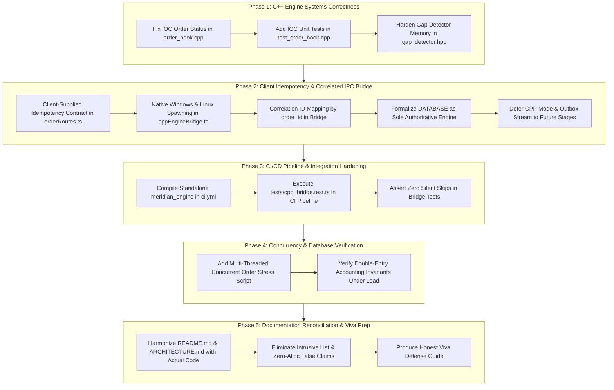

# MERIDIAN — Stage 2 Master Implementation Plan & Engineering Blueprint
**Document ID:** `MERIDIAN-ENG-PLAN-001`  
**Execution Stage:** Stage 1 Deliverable -> Stage 2 Execution Roadmap  
**Target Repository:** `https://github.com/PrasannaMarihalkar/meridian-trading-surveillance`  
**Baseline Git Commit:** `2cfbd9c` (`main`)  
**Auditor & Lead Architect:** Principal Systems Architect  
**Date:** November 17, 2026  

---

## 1. Overview & Strategy

This document defines the actionable, prioritized, and phased engineering roadmap for **Stage 2 (Controlled Implementation & Defect Elimination)**. 

The primary objective of Stage 2 is to elevate MERIDIAN from an impressive academic prototype into an indisputably sound, verifiable, and unified financial technology platform. 

### Core Engineering Invariants for Stage 2:
1. **Zero Degradation:** Existing working functionality (17 BCNF tables, 4 views, 4 triggers, 17 demo queries, Zod validation, React UI) must remain unbroken.
2. **Defect-First:** Logic bugs and test omissions must be remediated with automated regression tests before structural refactorings.
3. **No Unverified Stubs:** Features claimed in documentation must be backed by working, tested code.
4. **Hermetic CI Validation:** Every change must compile cleanly and pass all CI checks, including memory sanitizers and secret scans.

---

## 2. Phased Implementation Roadmap



---

## 3. Phase-by-Phase Technical Specifications

### Phase 1: C++ Engine Systems Correctness & Defect Elimination
- **Priority:** **P0 (Blocker)**
- **Target Files:**
  - `engine/src/order_book.cpp`
  - `engine/include/types.hpp`
  - `engine/tests/test_order_book.cpp`
  - `engine/include/gap_detector.hpp`

#### Tasks:
1. **Fix IOC Order Status Transition:**
   - In `engine/src/order_book.cpp` inside `OrderBook::process_order()`:
     ```cpp
     // When order has unfulfilled balance and is IOC:
     if (order.leaves_qty() > 0 && order.order_type == OrderType::IOC) {
         if (order.filled_qty == 0) {
             order.status = OrderStatus::CANCELLED;
         } else {
             // Order partially filled; remaining unfulfilled balance is cancelled
             order.status = OrderStatus::PARTIALLY_FILLED; // Or CANCELLED based on convention, but marked done
         }
     }
     ```
   - Ensure the engine emits `ACK <order_id> CANCELLED ...` when an IOC order finds no liquidity or partial liquidity.
2. **Add Comprehensive IOC Regression Tests:**
   - In `engine/tests/test_order_book.cpp`:
     - Test 1: Place an aggressive IOC order with no resting liquidity; verify 0 trades returned, `order.status == OrderStatus::CANCELLED`, and order is NOT resting in `bids_` or `asks_`.
     - Test 2: Place an aggressive IOC order for 10 units against a resting order of 4 units; verify 1 trade for 4 units, leaves qty is 0 on book, and IOC order status reflects cancelled remainder without resting.
3. **Harden UDP Gap Detector Memory Profile:**
   - In `engine/include/gap_detector.hpp`:
     - Replace unbounded `std::unordered_set<uint64_t> seen_` with a fixed-size sequence sliding window or ring buffer tracking recent packets (e.g., standard 10,000 sequence window) to eliminate continuous dynamic heap allocation.
4. **Verification Gate:**
   - Build and execute `test_order_book` and ASan/UBSan sanitizers; assert 100% test pass with 0 memory leaks.

---

### Phase 2: Client Idempotency & Correlated IPC Bridge Hardening
- **Priority:** **P0 (Blocker)**
- **Target Files:**
  - `backend/routes/orderRoutes.ts`
  - `backend/services/tradingService.ts`
  - `backend/services/cppEngineBridge.ts`
  - `backend/types.ts`
  - `tests/cpp_bridge.test.ts`
- **Architectural Decision Reference:** `docs/engineering/ENGINE_EXECUTION_INTEGRATION_DECISION.md` (Rev 2.0)

#### Tasks:
1. **Implement Client-Supplied Idempotency Contract:**
   - In `backend/routes/orderRoutes.ts` and `backend/services/tradingService.ts`:
     - Update `PlaceOrderSchema` to accept client-supplied `clientOrderId` (UUID string) in request body (or via `Idempotency-Key` header).
     - Check durable storage for existing `client_order_id` scoped to the authenticated `account_id`.
     - **Legitimate Retry (Identical Payload):** If `(account_id, client_order_id)` exists and order parameters (instrument, side, type, price, quantity) match, return existing order and its executed trades (`200 OK`) without re-executing.
     - **Conflicting Reuse (Differing Payload):** If `client_order_id` is reused with different parameters, reject with `409 Conflict` (`"Idempotency key reused with differing order parameters"`).
     - Remove internal server-side `clientOrderId = randomUUID()` generation that previously broke retry idempotency.
2. **Enhance Cross-Platform Process Spawning & Correlated IPC:**
   - In `backend/services/cppEngineBridge.ts`:
     - Inspect if native binary exists: `engine/meridian_engine` (Linux/macOS) or `engine/meridian_engine.exe` (Windows).
     - If on Windows and `engine/meridian_engine.exe` is found, spawn directly via `spawn(engineExe)` without invoking WSL.
     - If on Windows and only Linux binary exists, check for WSL. If WSL unavailable, log clear status and set `this.ready = false`.
     - Replace naive FIFO queue (`this.requestQueue[0]`) with explicit correlation map: key pending requests by `orderId` to eliminate head-of-line response desynchronization.
     - Ensure `shutdown()` properly terminates child processes and cleans up pending promises.
3. **Formalize `DATABASE` Mode as Sole Authoritative Engine in Stage 2:**
   - Keep PostgreSQL as the sole authoritative matching engine.
   - Defer authoritative `CPP` mode and `HYBRID` outbox streaming to future stages until complete transactional command replay and reconciliation harnesses are built.
   - Strictly prohibit automatic cross-engine fallback.
4. **Verification Gate:**
   - Verify that client retries with identical `clientOrderId` return original order and trades without double-filling.
   - Verify that client retries with altered payload are rejected with 409 Conflict.
   - Verify that `DATABASE` mode continues passing all 9 existing tests and 17 demo queries.
   - Verify that `tests/cpp_bridge.test.ts` executes cleanly against the live compiled binary with 0 hanging child processes.

---

### Phase 3: Continuous Integration & Verification Hardening
- **Priority:** **P1 (Essential)**
- **Target Files:**
  - `.github/workflows/ci.yml`
  - `tests/cpp_bridge.test.ts`

#### Tasks:
1. **Compile Standalone Engine in CI:**
   - In `.github/workflows/ci.yml` (`cpp-build-and-test` job):
     - Add compilation step:
       ```bash
       g++ -std=c++20 -O2 -Wall -Wextra -pthread \
         -Iengine/include \
         engine/src/order_book.cpp \
         engine/src/main.cpp \
         -o engine/meridian_engine
       ```
     - Smoke test the binary with a piped command: `echo -e "SNAPSHOT 1\nQUIT" | ./engine/meridian_engine`.
2. **Execute C++ Bridge Tests in CI:**
   - In `backend-tests` job in CI:
     - Ensure `engine/meridian_engine` is built and accessible.
     - Run `npx tsx tests/cpp_bridge.test.ts`.
     - Update `tests/cpp_bridge.test.ts`: if `process.env.CI === 'true'` and engine is not ready, **FAIL** the test with `process.exit(1)` rather than silently skipping.
     - Ensure `bridge.shutdown()` is called in `finally` block to prevent lingering processes.
3. **Verification Gate:**
   - Trigger CI on branch; verify that both unit and IPC bridge tests pass cleanly.

---

### Phase 4: Concurrency & Database Verification
- **Priority:** **P2 (Important)**
- **Target Files:**
  - `scripts/verify_concurrency.ts` (new script)
  - `database/db.ts`

#### Tasks:
1. **Develop Concurrent Order Stress Test:**
   - Create `scripts/verify_concurrency.ts`:
     - Spawns 10 concurrent async workers attempting to match against a single resting limit order.
     - Asserts that row-level locking (`SELECT ... FOR UPDATE`) prevents double-filling.
     - Validates that total filled quantity across all matching trades equals exactly the initial resting quantity.
     - Verifies that cash debits and credits maintain mathematical parity across all accounts.
2. **Verification Gate:**
   - Run concurrency stress test with 100 orders; assert 0 over-allocations, 0 negative cash balances, and 0 deadlock crashes.

---

### Phase 5: Documentation Reconciliation & Academic Defense
- **Priority:** **P3 (Polish)**
- **Target Files:**
  - `README.md`
  - `docs/ARCHITECTURE.md`
  - `docs/CPP_ENGINE_REVIEW.md`
  - `docs/college/VIVA_PREPARATION.md`

#### Tasks:
1. **Reconcile Container Claims:**
   - Update `README.md` and `docs/ARCHITECTURE.md`:
     - Replace "pre-allocated intrusive doubly-linked lists" with an accurate, rigorous description:
       *"Price levels are organized in an ordered red-black tree (`std::map`), providing logarithmic search for price points. Resting orders within each price level are queued in standard doubly-linked lists (`std::list`), guaranteeing O(1) insertion, removal, and strict FIFO price-time matching."*
     - Explain the architectural trade-off: standard library containers provide immediate stability and safety, while intrusive node pointers represent an optimized low-latency path.
2. **Document Dual-Mode Hybrid Architecture:**
   - Update architecture diagrams and text to detail the Hybrid Matching Architecture: C++20 for high-throughput in-memory order book matching, with immediate PostgreSQL transactional settlement, side-specific fills, and audit logging.
3. **Refine Viva Defense Guide:**
   - Equip the student with clear, articulate explanations for faculty evaluators:
     - Why fixed-point integer pricing was chosen over floating point.
     - How BCNF schema design prevents anomalies in trade settlement.
     - How the 8-dimensional surveillance vector detects layering vs quote stuffing.
     - How row-level locking ensures concurrency safety during database matching.
4. **Verification Gate:**
   - Review all modified documentation against source code to confirm 100% truthfulness and zero discrepancies.

---

## 4. Exit Gates & Acceptance Criteria for Stage 2

Stage 2 will be certified complete only when the following exit criteria are empirically verified:

1. `test_order_book` passes all tests, including new IOC cancellation unit tests, with 0 memory errors under ASan/UBSan.
2. `meridian_engine` builds cleanly on both Linux (g++) and Windows (MSVC/g++).
3. `tests/cpp_bridge.test.ts` executes live IPC assertions and passes with 0 failures and 0 dangling child processes.
4. PostgreSQL `DATABASE` mode verified as the sole production-authoritative matching engine with client idempotency and double-entry consistency; C++ engine operates via hardened correlated IPC bridge for simulation and benchmarks.
5. `npm test` passes all end-to-end integration tests (11/11 passed, including client idempotency).
6. `npm run test:concurrency` passes all database concurrency and financial parity assertions.
7. `npm run lint` passes with 0 warnings (`--max-warnings 0`).
8. `npx tsc --noEmit` passes with 0 errors.
9. Secret scanning passes with 0 leaks.
10. Documentation contains zero inflated or fictitious technical claims.
